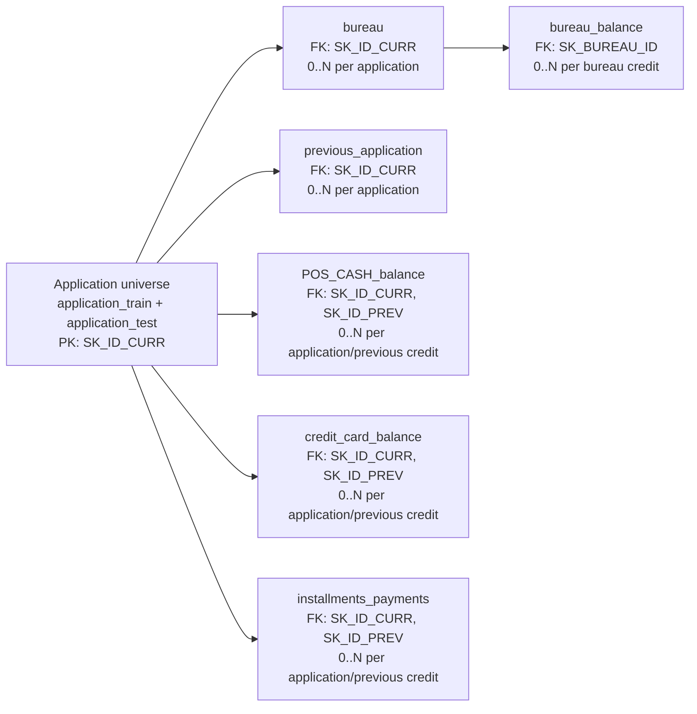

# Application data map

Scope: `HomeCredit_columns_description.csv`, `application_train.csv`, and
`application_test.csv` only. This is a structural/data-dictionary check, not
EDA. The dictionary calls `SK_ID_CURR` the ID of a loan in the sample, so the
word *applicant* below means a distinct `SK_ID_CURR` record rather than a
separately established person-level entity.

## `application_train.csv`

- **Grain and size:** one sampled current loan application (`SK_ID_CURR`), with
  an observed payment-difficulty target; **307,511 rows**.
- **Primary key:** `SK_ID_CURR`; unique and non-null (**307,511 distinct IDs**,
  no duplicate or blank IDs).
- **Foreign keys:** none declared in this table. `SK_ID_CURR` is the table's
  own application/loan identifier, not a foreign key to `application_test`.
  The two application files have no shared `SK_ID_CURR` values, so a join
  between them has **0 matching rows** (not a 1:1 relationship).
- **Share of train applicants with at least one row:** **100.00%**
  (307,511 / 307,511), by definition of this parent application table.

## `application_test.csv`

- **Grain and size:** one sampled current loan application (`SK_ID_CURR`) for
  which the target is withheld; **48,744 rows**.
- **Primary key:** `SK_ID_CURR`; unique and non-null (**48,744 distinct IDs**,
  no duplicate or blank IDs).
- **Foreign keys:** none declared. Although the column name is shared with
  `application_train`, it is an identifier in a disjoint sample partition, not
  a foreign-key reference. The attempted `SK_ID_CURR` join to train has
  **0 matches**.
- **Share of application_train applicants with at least one row:** **0.00%**
  (0 / 307,511), because the two ID sets are disjoint.

## Dictionary exceptions and caveats

The following are value-level contradictions or undocumented semantic values
relative to the supplied dictionary.

| Table | Column | Finding |
| --- | --- | --- |
| `application_train.csv` | `DAYS_EMPLOYED` | **55,374** values are positive, all `365243`. The dictionary says this is the number of days *before* the application that current employment began; a positive value places it after the application (and is clearly a sentinel). |
| `application_test.csv` | `DAYS_EMPLOYED` | **9,274** values are positive, all `365243`, with the same contradiction/sentinel issue. |
| `application_test.csv` | `REGION_RATING_CLIENT_W_CITY` | One row (`SK_ID_CURR = 224393`) has `-1`; the dictionary explicitly defines the rating domain as `1, 2, 3`. |
| `application_train.csv` | `CODE_GENDER` | Four rows use `XNA`. The dictionary describes this as the client's gender but does not document an unknown/not-applicable code. |

Schema caveat: the dictionary labels `TARGET` as belonging to
`application_{train|test}.csv`, but `TARGET` is present only in train (122
columns) and absent from test (121 columns). This is a dictionary-to-schema
mismatch, not a value-level contradiction.

## Column inventory and nullability

Types below are logical types, rather than the string representation used in
the CSV files. **Required** means no nulls were observed in
`application_train.csv`; **nullable** means at least one null was observed
there. The test file has the same feature columns except `TARGET`, but its
nullability should be checked again whenever it is replaced.

| Logical group / columns | Logical type | Nullability and use notes |
| --- | --- | --- |
| `SK_ID_CURR` | integer identifier | Required; primary key. Do not use as a predictive feature. |
| `TARGET` (train only) | binary integer (`0`/`1`) | Required; the supervised-learning label. Never include it in the feature matrix. |
| `NAME_CONTRACT_TYPE`, `CODE_GENDER`, `FLAG_OWN_CAR`, `FLAG_OWN_REALTY`, `NAME_TYPE_SUITE`, `NAME_INCOME_TYPE`, `NAME_EDUCATION_TYPE`, `NAME_FAMILY_STATUS`, `NAME_HOUSING_TYPE`, `ORGANIZATION_TYPE`, `WEEKDAY_APPR_PROCESS_START` | categorical | All required except `NAME_TYPE_SUITE` (1,292 nulls). `CODE_GENDER` contains the undocumented `XNA` code; treat it as an explicit unknown category. |
| `CNT_CHILDREN`, `CNT_FAM_MEMBERS`, `REGION_RATING_CLIENT`, `REGION_RATING_CLIENT_W_CITY`, `HOUR_APPR_PROCESS_START`, `OBS_30_CNT_SOCIAL_CIRCLE`, `DEF_30_CNT_SOCIAL_CIRCLE`, `OBS_60_CNT_SOCIAL_CIRCLE`, `DEF_60_CNT_SOCIAL_CIRCLE`, `AMT_REQ_CREDIT_BUREAU_HOUR`, `AMT_REQ_CREDIT_BUREAU_DAY`, `AMT_REQ_CREDIT_BUREAU_WEEK`, `AMT_REQ_CREDIT_BUREAU_MON`, `AMT_REQ_CREDIT_BUREAU_QRT`, `AMT_REQ_CREDIT_BUREAU_YEAR` | integer/count or ordinal | `CNT_FAM_MEMBERS` is nullable (2 nulls); all four social-circle counts are nullable (1,021 each); all six bureau-enquiry counts are nullable (41,519 each). The remaining listed fields are required. Ratings are documented as 1–3, subject to the test exception noted above. |
| `AMT_INCOME_TOTAL`, `AMT_CREDIT`, `AMT_ANNUITY`, `AMT_GOODS_PRICE` | currency/decimal | Income and credit are required. Annuity is nullable (12 nulls) and goods price is nullable (278 nulls). |
| `REGION_POPULATION_RELATIVE`, `EXT_SOURCE_1`, `EXT_SOURCE_2`, `EXT_SOURCE_3` | continuous numeric / normalized score | Population is required. All external-source scores are nullable (`173,378`, `660`, and `60,965` nulls respectively). Treat score scale and provenance as external/undocumented. |
| `DAYS_BIRTH`, `DAYS_EMPLOYED`, `DAYS_REGISTRATION`, `DAYS_ID_PUBLISH`, `DAYS_LAST_PHONE_CHANGE` | integer day offset relative to application | First four are required; last-phone-change has 1 null. Values use a negative-before-application convention, except the documented data-quality sentinel in `DAYS_EMPLOYED`. |
| `OWN_CAR_AGE`, `OCCUPATION_TYPE` | integer age; categorical occupation | Both nullable: `OWN_CAR_AGE` has 202,929 nulls and `OCCUPATION_TYPE` has 96,391 nulls. Do not automatically treat car-age null as zero. |
| `REG_REGION_NOT_LIVE_REGION`, `REG_REGION_NOT_WORK_REGION`, `LIVE_REGION_NOT_WORK_REGION`, `REG_CITY_NOT_LIVE_CITY`, `REG_CITY_NOT_WORK_CITY`, `LIVE_CITY_NOT_WORK_CITY`, `FLAG_MOBIL`, `FLAG_EMP_PHONE`, `FLAG_WORK_PHONE`, `FLAG_CONT_MOBILE`, `FLAG_PHONE`, `FLAG_EMAIL`, `FLAG_DOCUMENT_2`–`FLAG_DOCUMENT_21` | binary indicator | Required. Dictionary semantics indicate 0/1; validate this domain on every reload. |
| `APARTMENTS_*`, `BASEMENTAREA_*`, `YEARS_BEGINEXPLUATATION_*`, `YEARS_BUILD_*`, `COMMONAREA_*`, `ELEVATORS_*`, `ENTRANCES_*`, `FLOORSMAX_*`, `FLOORSMIN_*`, `LANDAREA_*`, `LIVINGAPARTMENTS_*`, `LIVINGAREA_*`, `NONLIVINGAPARTMENTS_*`, `NONLIVINGAREA_*` where `*` is `AVG`, `MODE`, or `MEDI` | continuous numeric building attributes | All 42 fields are nullable. They are normalized building information, not raw physical units; preserve the statistic suffix rather than combining the fields blindly. |
| `FONDKAPREMONT_MODE`, `HOUSETYPE_MODE`, `WALLSMATERIAL_MODE`, `EMERGENCYSTATE_MODE` | categorical building attributes | All nullable. |
| `TOTALAREA_MODE` | continuous normalized building attribute | Nullable. |

## Target, time, and missing-value rules

- **Target governance:** `TARGET = 1` denotes a client with payment
  difficulties (late payment more than the dictionary's unspecified *X* days
  on at least one of the first *Y* installments); `0` means all others. The
  exact X and Y thresholds are not supplied, so they must not be inferred or
  represented as a business policy. Test labels are absent by design. Split,
  preprocessing, and feature selection must be learned only from training
  data, and `TARGET` must be excluded from model features.
- **Reference time:** all `DAYS_*` fields are offsets from the current
  application date; values before the application should be non-positive.
  `DAYS_BIRTH` is an age expressed as a negative day count, not a date of
  birth. `DAYS_LAST_PHONE_CHANGE` is nullable. The historical-table field
  `MONTHS_BALANCE` (described in the dictionary) is likewise relative to this
  application date.
- **Sentinel rule:** map `DAYS_EMPLOYED = 365243` to missing/unknown before
  modeling, while retaining an `is_employment_sentinel` indicator if useful.
  This affects 55,374 train rows and 9,274 test rows. Do not convert it to an
  employment duration or use it as a literal date offset.
- **Missing categories:** retain categorical nulls as an explicit missing
  level where the modeling method requires a value. Do not conflate null with
  zero, `N`, or `XNA`. In particular, a null `OWN_CAR_AGE` is not evidence of
  a zero-year-old car.

## Documented relationship map

The files available for inspection are only the two application partitions.
The diagram below records **dictionary-declared** downstream relationships;
it does not assert that those files are present or that their coverage has
been measured. The dictionary does not state how child records divide between
the train and test partitions, so their parent is shown as the combined
application universe.

`SK_ID_PREV` and `SK_BUREAU_ID` do not occur in either application CSV, so
they are not keys of these two tables. Before materializing any joins, measure
child coverage and key uniqueness in the child files; joining multiple
one-to-many tables directly will multiply rows.

## Data-quality checks for every delivery

1. Verify exact schemas: train must contain 122 columns including `TARGET`;
   test must contain the same 121 non-target columns in the expected names.
2. Verify `SK_ID_CURR` is non-null and unique within each partition, and that
   train/test `SK_ID_CURR` sets remain disjoint unless a new delivery documents
   a changed split.
3. Validate `TARGET` is only 0 or 1; binary indicators are only 0 or 1; and
   both regional-rating fields are only 1, 2, or 3. The known test `-1`
   exception should be handled deliberately rather than silently accepted.
4. Recount `DAYS_EMPLOYED = 365243`; ensure no other positive
   before-application day offsets enter without a documented exception.
5. Monitor null counts by column, especially external scores, building
   attributes, occupation, car age, and credit-bureau enquiry counts. A sharp
   change may be a source-system change rather than a real population shift.
6. For each historical child table, test foreign-key coverage against the
   combined application universe and aggregate to `SK_ID_CURR` before joining
   back to applications.

## Source, version, and ownership record

The supplied files contain no authoritative source-system, refresh cadence, or
business-data-owner metadata. The following fingerprints identify the exact
local input snapshot used for this map; the displayed file modification times
are local filesystem metadata, not verified source publication dates.

| File | SHA-256 | Size | Local modified time |
| --- | --- | ---: | --- |
| `HomeCredit_columns_description.csv` | `eef7665398228a80f7367c9258220c5fbe1038f3f54094244f354d54e2d4fb03` | 37,383 bytes | 2026-09-25 21:43:25 -0600 |
| `application_train.csv` | `52e96b895b1112e1c853f670e58372719c8441c5ed1c57ac2f7fad559d784f5f` | 166,133,370 bytes | 2019-12-11 02:58:06 -0700 |
| `application_test.csv` | `a36161331d839150a67b6216d4de066f543a3b01a34061507d40e76612e0dec8` | 26,567,651 bytes | 2019-12-11 02:58:06 -0700 |

Before production use, add the upstream dataset URL or contract, source owner,
business-definition owner, refresh cadence, retention classification, and the
approved change-control contact. None can be inferred reliably from these
CSV files.
